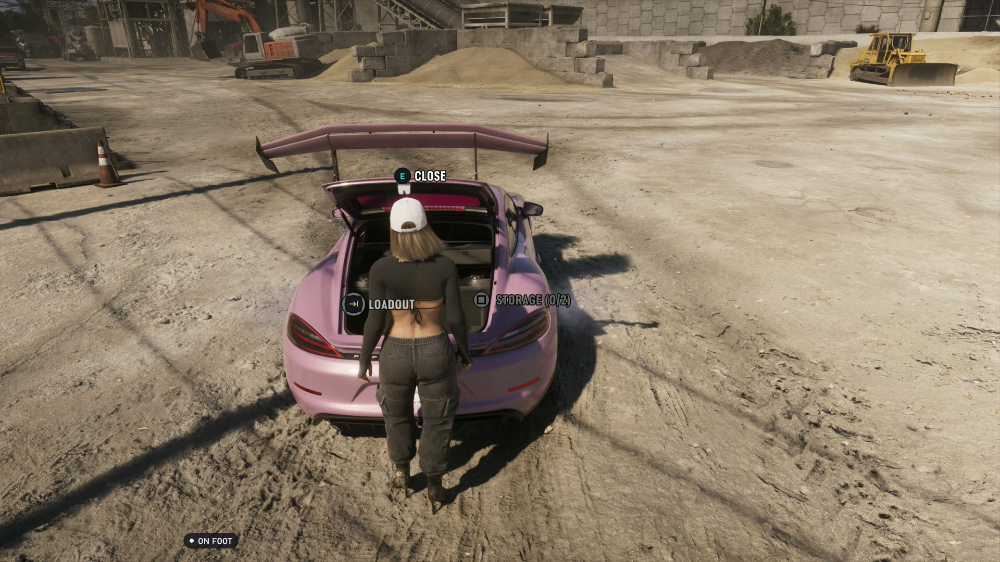
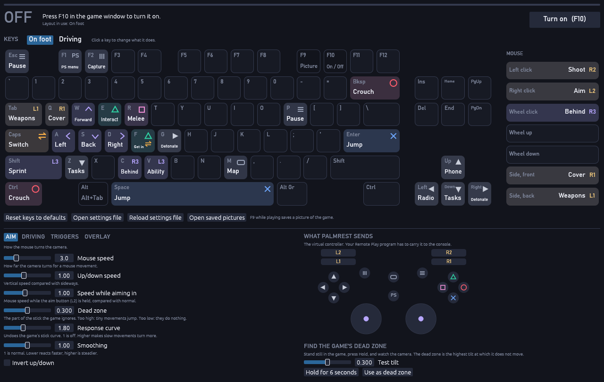
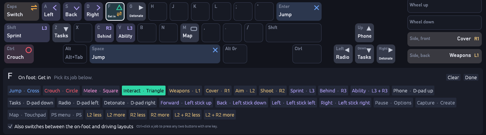
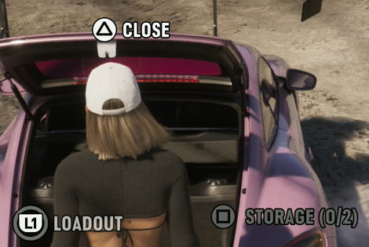
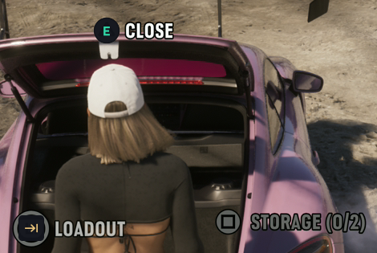
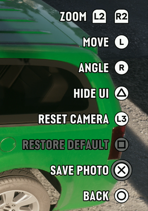
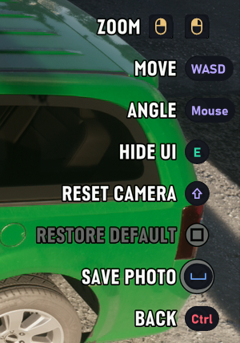
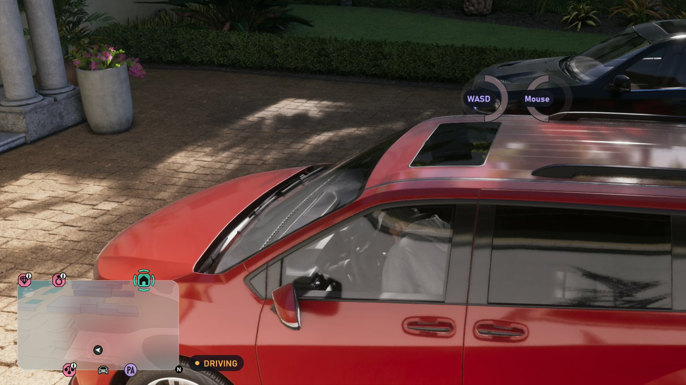

<p align="center"></p>

# Palmrest

Keyboard and mouse for GTA 6 on PS5.

Palmrest runs on a Windows PC beside a Remote Play client. It turns your keyboard and mouse into a virtual controller, the client carries that controller to the console, and the game never knows the difference. It also reads the game's picture and shows your own key on top of each button prompt, so "press ✕" becomes "press Space".



I made this because my hands kept cramping up from holding a controller during long sessions. I'm a PC gamer, and a keyboard and mouse is just what my hands are used to.

Palmrest is not made, endorsed or supported by Rockstar Games, Take-Two Interactive or Sony. It is meant for playing the story on your own.

## What it does

- **Keys and mouse as a controller.** Keys are buttons and the left stick; the mouse is the right stick, shaped so that the camera follows your hand and not the game's stick curve.
- **Two sets of keys**, on foot and driving, because W cannot be both "walk forward" and "accelerate". One key switches between them.
- **Your keys on the game's prompts.** A small see-through layer on top of the game finds the button prompts on screen and draws the key you would press, on the prompt itself. Nothing is drawn into the game's own picture.
- **Triggers part of the way.** A key is all or nothing, but a few things in the game want L2 or R2 held half-way or let down slowly. The mouse wheel, or keys you choose, set how far the trigger keys pull.
- **A real controller as well**, for the things that are made for two thumbs, like flying. Connect one to the PC, pick it up and it works; put it down and the keys work.
- **Change any key by clicking it** on a drawing of the keyboard.
- **One exe.** No installer, no account, no network access. Settings are a text file.



## What you need

- A PC with Windows 10 or 11.
- The [ViGEmBus driver](https://github.com/nefarius/ViGEmBus/releases), which is what lets a program act as a controller.
- A Remote Play client that takes a controller on the PC and passes it to the PS5. I use **Veyra** (see [How I play](#how-i-play)). chiaki-ng, Chiaki and Sony's PS Remote Play are in the list of windows Palmrest switches on for, but nobody has tried them yet. If you do, please say how it went.
- A PS5 with Remote Play turned on, and the game.

How the picture reaches your screen is up to you: the Remote Play stream itself, or a capture card.

## How I play

This is how I play the game, and the setup I highly recommend:

- The PS5's picture goes into the PC through a **capture card** (mine is an Elgato HD60 S).
- **[Veyra](https://github.com/Likely7/Veyra-NRVideo)** shows that picture on the PC, and it also supports sending a controller to the PS5 over **Remote Play**. That controller is Palmrest.
- Palmrest runs beside it and turns my keyboard and mouse into that controller.

The picture comes over the cable instead of as a Remote Play stream, so only the controller goes over the network. It has been a pretty smooth experience for me.

### Turning on the controller in Veyra

The capture card only brings the picture in. The controller goes to the PS5 over Remote Play, and in Veyra that is a separate switch. This step tripped me up too:

1. On the PS5, turn on Remote Play (*Settings > System > Remote Play*).
2. In Veyra, pair the PS5 once under **PS5 streaming**. Veyra's [user guide](https://github.com/Likely7/Veyra-NRVideo/wiki) covers the pairing.
3. Open **Capture card** and, under **PS5 controller control**, turn on **Control the PS5 through Remote Play**. Then press **Connect and start**.
4. It should say **PS5 controller control connected**.

Until it says that, nothing you press reaches the game, even though the picture shows, the overlay works and the buttons light up in the Palmrest window.

## Getting started

1. Install ViGEmBus and restart if it asks.
2. Download `palmrest.exe` from the [latest release](https://github.com/nalyDzzz/palmrest/releases/latest) and put it wherever you like. There is nothing to install. The exe is not signed, so Windows may say it comes from an unknown publisher: *More info*, then *Run anyway*. You can also [build it yourself](#building-it).
3. Start `palmrest.exe`, then your Remote Play client, and connect to the console. Seeing the game's picture is not enough: the client has to be sending a controller. In Veyra with a capture card that is [its own switch](#turning-on-the-controller-in-veyra).
4. Click into the game's window and press **F10**. From now on the keyboard and mouse are the controller. **F10** again gives them back; so does switching to another window with Alt+Tab.
5. In the Palmrest window, under *Aim*, set the mouse speed to taste. If small mouse movements do nothing, or tiny ones jump, use *Find the game's dead zone* on the right.

Palmrest only takes keys while it is switched on **and** the game's window is in front. Everywhere else your keyboard and mouse are untouched.

### If the game does not react

If the overlay shows and the buttons light up in the Palmrest window, but nothing happens in the game, the controller is not reaching the console. Three things to check:

- **A red line in the Palmrest window** saying "No controller is being sent" means the ViGEmBus driver is missing.
- **In Veyra**, it has to say **PS5 controller control connected**. See [Turning on the controller in Veyra](#turning-on-the-controller-in-veyra).
- **A normal controller plugged into the PC**, not the PS5, should work the game through your Remote Play client. If it does not, the client's setup is where to look. If it does and Palmrest still does nothing, please [open an issue](https://github.com/nalyDzzz/palmrest/issues).

## The keys it starts with

Every one of these can be changed: click the key in the Palmrest window and pick its job.

| On foot | | Driving | |
|---|---|---|---|
| W A S D | move | W / S | accelerate / brake |
| Mouse | look and aim | A / D | steer |
| Left click / Right click | shoot (R2) / aim (L2) | Mouse | look |
| Space | jump (✕) | Space | handbrake (✕) |
| Ctrl | crouch (○) | H | headlights (○) |
| E | interact (△) | F | get out (△), back to the on-foot keys |
| F | get in (△), switches to the driving keys | E | horn (L3) |
| R | melee (□) | R | □ |
| Q | cover (R1) | Q | radio (d-pad left) |
| Tab | weapon wheel (L1) | Tab | L1 |
| Shift | run (L3) | C | look behind (R3) |
| C | look behind (R3) | Left click / Right click | R1 / L1 |
| V | ability (L3 + R3) | V | ability (L3 + R3) |
| M, P or Esc | map, pause | M, P or Esc | map, pause |
| Arrow keys | d-pad | Arrow keys | d-pad |

**Caps Lock** switches between the two sets by hand. **F9** saves a picture of the game into Palmrest's folder, and **F1** is the PS button.



Click a key and pick its job. A key can also switch between the two sets of keys, as F does here, and Ctrl+click on a job lets one key press two buttons at once.

## Your keys on the game's prompts

While you play, Palmrest looks at the game's picture a few times a second, finds the button prompts (✕ ○ □ △, the sticks, L1 to R3), and draws the key for each one on top of it. A small label at the bottom left says which set of keys is in use.

| The game | With Palmrest |
|:-:|:-:|
|  |  |
|  |  |

Each prompt gets the key nearest your hand: Space rather than Enter for ✕, Ctrl rather than Backspace for ○. A mouse button is drawn as a small mouse with that button filled in. A prompt the game has greyed out, like "Storage" and "Restore default" above, gets no key.

The overlay is still experimental. Every now and then you'll see a key drawn over the wrong icon, but it isn't common.



Hot-wiring, from the driver's seat. The driving keys are in use, as the label says, but while the game asks for the left stick, WASD work it, and the prompt says so.

It can look more often, under *Overlay*: keys then appear sooner and stay on a prompt that moves, for more processor time. The window shows what each look costs on your PC.

Prompts it does not know yet: the d-pad, the touchpad and Options.

## Triggers part of the way

Under *Triggers*:

- **With the wheel.** Turn it on, hold a trigger key, and scroll: down for less pull, up for more. With both trigger keys held it moves both together; a held trigger comes down smoothly however fast you scroll, which is what lowering a weight slowly needs.
- **With keys.** Give any key the job *L2 less*, *L2 more*, *R2 less*, *R2 more*, *L2 + R2 less* or *L2 + R2 more*. The pull moves while that key is held and stays when you let go.

The label on the game shows the pull while it is not all the way, and it goes back to all the way a few seconds after you let go of the triggers.

## A controller as well

Some things in the game are made for two thumbs, flying most of all. Connect a DualSense or a DualShock 4 to the PC, by cable or Bluetooth, and Palmrest adds what you do on it to what the keys and the mouse do. There is nothing to switch:

- **Pick it up and it works.** It counts from the moment you touch a stick, a trigger or a button.
- **Put it down and the keys work.** The next key press or mouse movement takes over again, so a controller lying on the desk presses nothing by its own weight.
- While you play on the controller, the keys drawn on the game's prompts are hidden, so you can see which button the game is asking for.
- It works with the takeover (F10) turned off too.

The window says which controller it found, under *Controller*, and its sticks and buttons show in the drawing of what Palmrest sends. The controller has to be connected to the PC, not to the PS5.

Not carried over: rumble, the adaptive triggers, the motion sensors and swipes on the touchpad. A click on the touchpad is.

This part is new and has not been played with yet. If it misbehaves, turn it off under *Controller* and please [open an issue](https://github.com/nalyDzzz/palmrest/issues).

## Settings and pictures

Everything is in `%APPDATA%\Palmrest`: `config.toml`, which the window writes and which you can also edit by hand, and a `pictures` folder for what F9 saves. A `config.toml` placed beside the exe is used instead, for a copy that carries its settings with it.

## Good to know

- **It is slower than a controller plugged into the console.** Remote Play adds delay that no PC program can take away.
- **Switching between the on-foot and driving keys is done by key**: F as you get in and out, Caps Lock when that goes wrong. There is an experimental setting that switches when the vehicle's name appears on screen.
- **It has been used on one PC, one PS5 and one game**, at a 1920 x 1080 picture. Other sizes are scaled for but have not been tried.
- **Windows only.**
- **Some virus scanners distrust any program that watches the keyboard.** Palmrest reads keys only as described above, keeps nothing, and never goes online; the source is here to check.

## Bugs, ideas and pull requests

I made Palmrest for myself, so I've been its only playtester, and there are probably bugs I haven't found yet. I've been really happy with how it turned out, though, so I figured I'd share it.

I'm open to suggestions. If you have an idea, something doesn't work, or the overlay puts a key in the wrong place, [open an issue](https://github.com/nalyDzzz/palmrest/issues). For anything the overlay gets wrong, an F9 picture of that moment helps a lot.

Feel free to fork it, open pull requests for new features, or do whatever you like with it. If you do, I'd appreciate a star!

Happy gaming!

## Building it

With [Rust](https://rustup.rs) for Windows (the MSVC toolchain):

```
cargo build --release
```

The exe is `target\release\palmrest.exe`. `cargo test` runs the tests. The `tools` folder has the small scripts used to check the program against saved pictures of the game without the game running, and `assets/logo.py` draws the icon.

## Licence

MIT: see [LICENSE](LICENSE). The names of games, consoles and companies belong to their owners and are used here only to say what Palmrest works with.
